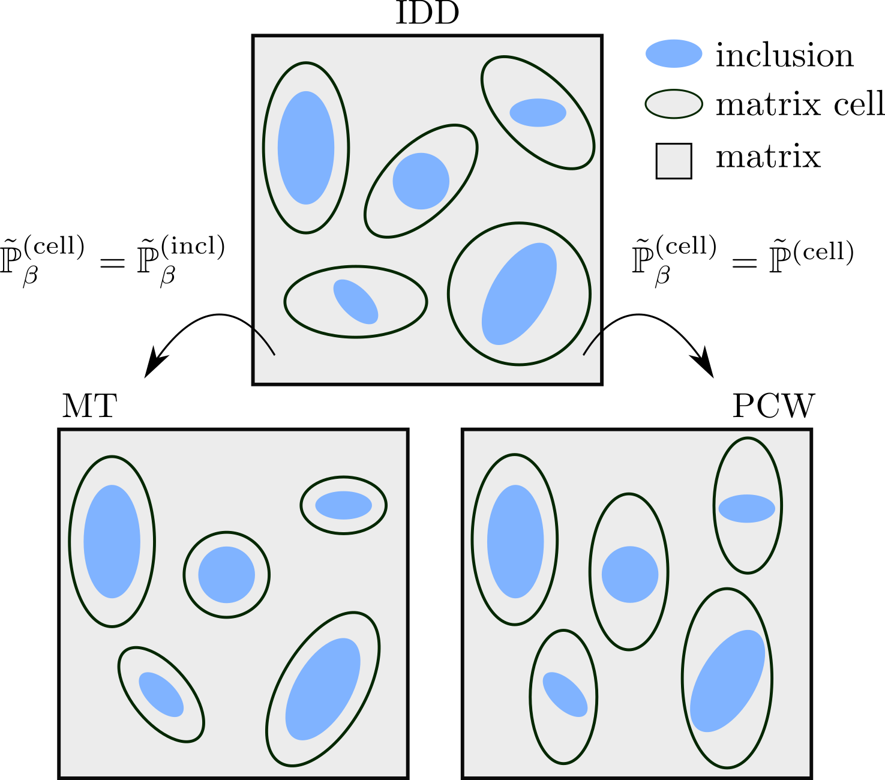
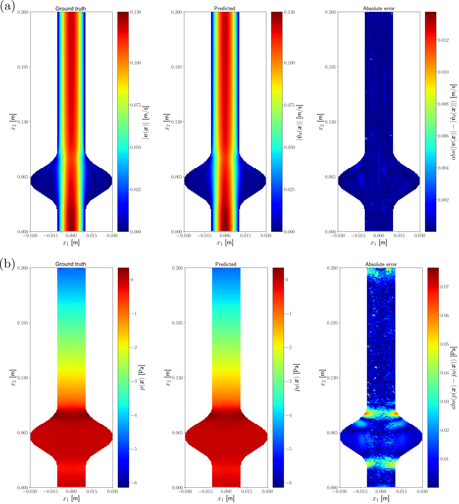
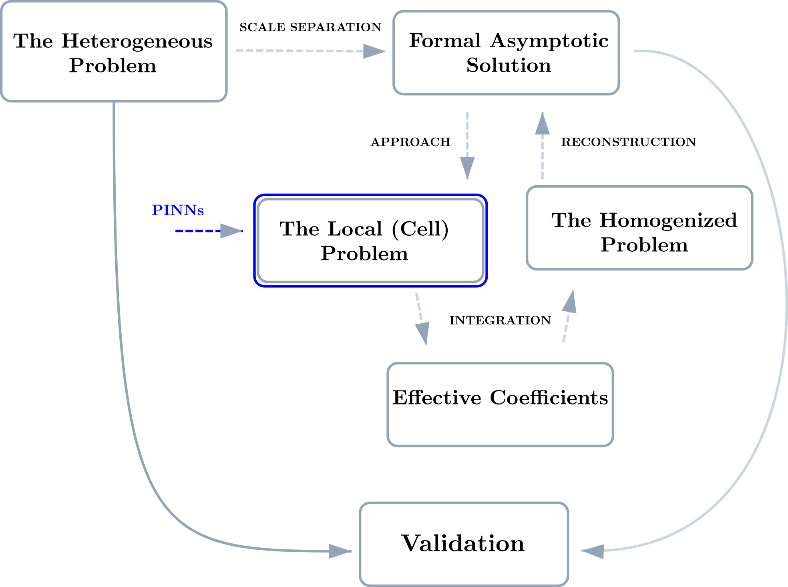
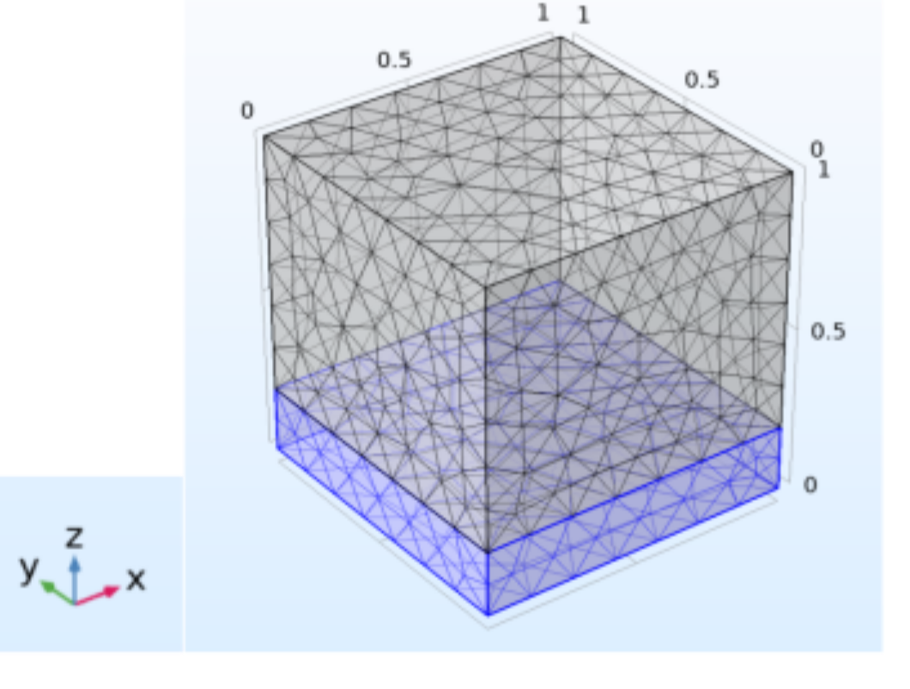
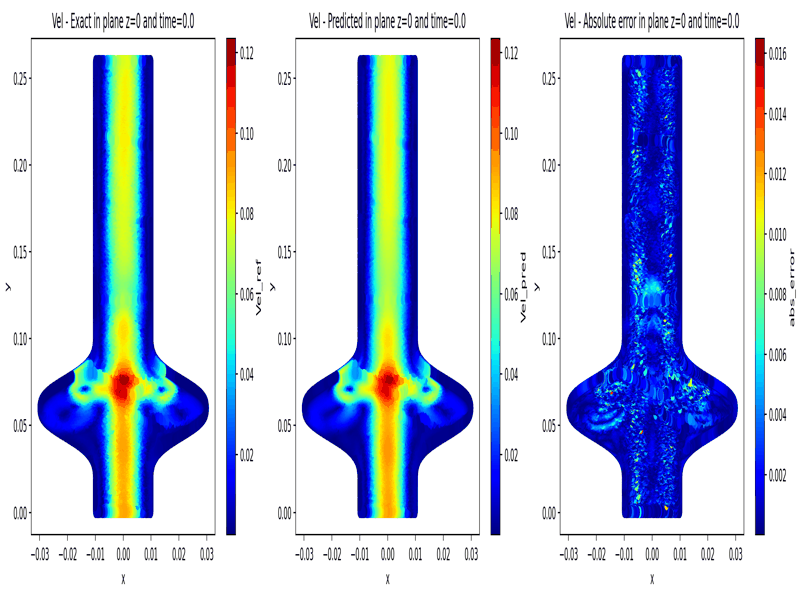
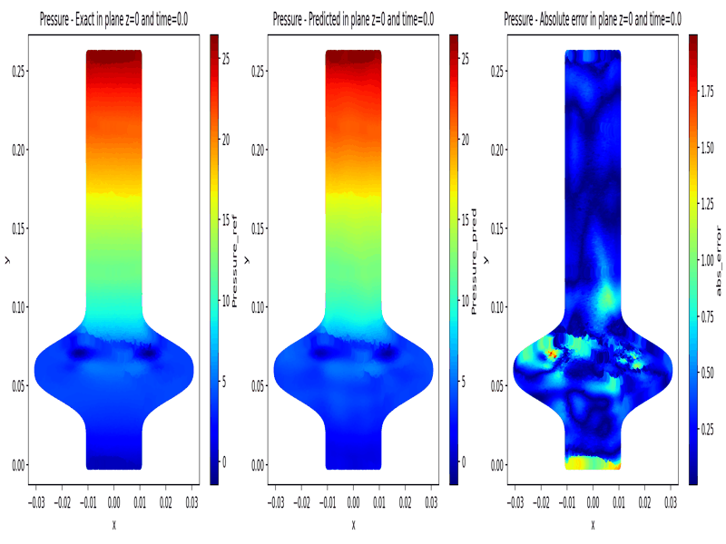

<!-- > **Media license** &mdash; Unless stated otherwise, the figures, animations and videos on this site are &copy; Oscar L. Cruz Gonz&aacute;lez and released under [Creative Commons Attribution 4.0 International (CC BY 4.0)](https://creativecommons.org/licenses/by/4.0/). You are free to share and adapt them, including commercially, provided you give appropriate credit and link to the license. Third-party logos and institutional marks are excluded &mdash; see [LICENSE-CONTENT](https://github.com/olcruzgonzalez/olcruzgonzalez.github.io/blob/main/LICENSE-CONTENT) for the exact scope.
{: .prompt-info } -->

## Codes

Open source numerical tools. 
<!-- -->

### pyhom 

  > *PyHom: a Python library for homogenization*\
  > This library is conceived for calculating the effective conductivity properties of composite materials with complex microstructures in a 2D framework.\
  > Documentation and examples can be found on the repository [olcruzgonzalez/pyhom](https://github.com/olcruzgonzalez/pyhom)
  
{: width="400" height="200" .w-50 .center}

### AAA_steady

  > This code implements several physics-based deep learning methods, such as PINNs and PI-DeepONets, to predict steady vascular flow in a 3D Abdominal Aortic Aneurysm (AAA) idealized model.\
  > Refer to the repository [olcruzgonzalez/AAA_steady](https://github.com/olcruzgonzalez/AAA_steady) for more details.
  
{: width="600" height="300" .w-50 .center}

### Project Finder: AHM + SciML

### AAA_unsteady

  > This code uses PINNs and PI-DeepONets to predict unsteady blood flow in a 3D Abdominal Aortic Aneurysm (AAA) idealized model.\
  > It is related to our work on unsteady flow, found at the repository [olcruzgonzalez/AAA_unsteady](https://github.com/olcruzgonzalez/AAA_unsteady)\
  > ***The code will be made public after peer review and acceptance of our associated manuscript.*
  
{: width="600" height="300" .w-50 .center}
{: width="600" height="300" .w-50 .center}

### Aorta

  > This code moves the physics-based deep learning workflow beyond idealized geometries and applies it to a patient-specific thoracic aorta. PINNs and PI-DeepONets are trained to reproduce the pulsatile blood flow over a complete cardiac cycle, and their predictions are then assessed against the reference CFD solution.\
  > It is part of our work on surrogate models for thoracic aorta pathologies, found at the repository [olcruzgonzalez/Aorta](https://github.com/olcruzgonzalez/Aorta)\
  > ***The code will be made public after peer review and acceptance of our associated manuscript.*

<!-- Encoded from the aorta_*.mkv masters: audio track removed and 4x playback speed baked into each file. -->

  <video class="embed-video file"
         src="/assets/video/projects/aorta/aorta_MoV.mp4"
         poster="/assets/video/projects/aorta/aorta_MoV-poster.jpg"
         controls controlslist="nodownload noplaybackrate" disablepictureinpicture disableremoteplayback
         autoplay loop muted playsinline preload="metadata"
         oncontextmenu="return false;">
    Your browser does not support the video tag.
  </video>
  <em>Velocity magnitude over one cardiac cycle: CFD reference (left), PINN prediction (center) and vector error magnitude (right).</em>

  <video class="embed-video file"
         src="/assets/video/projects/aorta/aorta_Pressure.mp4"
         poster="/assets/video/projects/aorta/aorta_Pressure-poster.jpg"
         controls controlslist="nodownload noplaybackrate" disablepictureinpicture disableremoteplayback
         autoplay loop muted playsinline preload="metadata"
         oncontextmenu="return false;">
    Your browser does not support the video tag.
  </video>
  <em>Pressure over the same cardiac cycle: CFD reference (left), PINN prediction (center) and signed error, PINN &minus; CFD (right).</em>

---